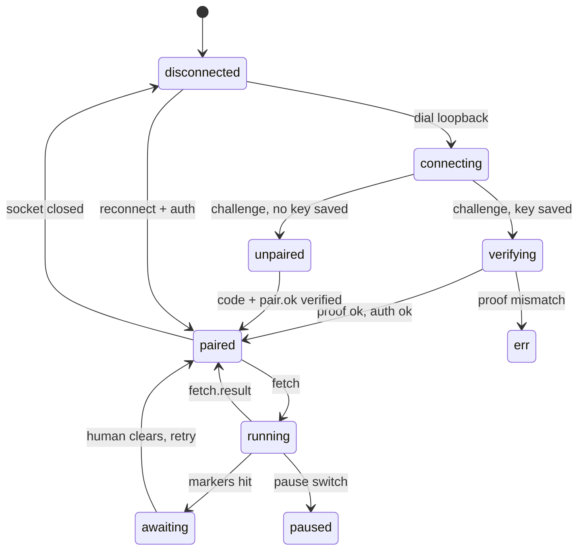

# Tomoshibi Bridge — the product

The M1b spike proved the borrow lane works: a real extension, a real browser, real
typing and clicking, a challenge that stops the run, zero debug toggle. This plan
turns that spike into a product a person installs and trusts. It replaces the
earlier "demo" framing: the extension is not a throwaway proof, it is the thing
users touch.

Stack decision, stated up front because it changes everything below: **WXT for
the build, Svelte 5 for the UI.** The reason is in the next section, and it
contradicts "WXT + SvelteKit" as literally stated.

## Why not SvelteKit inside the extension

WXT ships an official `@wxt-dev/module-svelte`, which adds
`@sveltejs/vite-plugin-svelte`. That is Svelte, not SvelteKit. WXT has no
SvelteKit integration, and its own docs say why: extension pages are static
files at fixed paths (`chrome-extension://{id}/popup.html`), so SvelteKit's path
routing and SSR have nowhere to live. The documented answer for routing is hash
mode, and WXT names `svelte-spa-router` for Svelte.

So the shape that keeps the stack the user actually wants:

| Layer | Choice | Why |
| ----- | ------ | --- |
| Build, manifest, dev server, HMR | WXT | Generates both manifests, two browser targets, one dev command |
| Components | Svelte 5 (runes) | Same component model as SvelteKit; the module supports it |
| Styling | Tailwind + shadcn-svelte | shadcn-svelte documents a **Vite** install path, so no SvelteKit tree is required |
| Routing | Hash routing, or none at all | A popup with three views does not need a router |
| Companion site (optional) | SvelteKit | Docs or landing page, built separately; never shipped inside the extension |

If literal SvelteKit inside the extension is non-negotiable, the cost is
`adapter-static` + `ssr = false` + hash routing + a hand-rolled manifest, and WXT
goes away. That trades a documented path for a bespoke one, and the spike's own
history (D20 flipped WXT to zero-build for auditability, now flipping back) is a
warning about how expensive these conversions are. Recommendation: don't.

## The surfaces

Three, each with one job. No in-page overlay, no injected UI on sites: an
overlay is both a detection tell and a permission the product does not need.

### Popup, 340 px — "is it working, and stop it"

```
┌──────────────────────────────────────┐
│ ● Connected            tomoshibi.dev │
│                                      │
│  Paired with this browser            │
│  API 127.0.0.1:7431 · protocol 1     │
│                                      │
│  ┌────────────┐  ┌────────────────┐  │
│  │ Open panel │  │ Pause          │  │
│  └────────────┘  └────────────────┘  │
│                                      │
│  Last run: 3 actions · 1.8 s         │
│  ──────────────────────────────────  │
│  Pairing                             │
│  [ 6-digit code ]  [ Pair ]          │
│                                      │
│  ⚠ last error, only when there is one│
└──────────────────────────────────────┘
```

- State dot and one sentence. Four states, no jargon: `on`, `pair`, `off`, `err`.
- Pair box only when connected and unpaired; the same rule the spike already has.
- Pause is a switch, not a menu. It is the one control that must never be buried.
- Everything else lives in the panel or options. The popup never scrolls at 320 px.

### Side panel — "what is it doing, and what did it do"

An agent run takes 20 to 60 seconds, and a popup closes the moment you click the
page. The side panel stays.

- **Live run:** origin, recipe id, IO layer, elapsed, the action list with a tick
  or a cross per action, and the reason on a refusal.
- **Awaiting human:** the same card turns amber, says what the page is waiting
  for, and offers "retry" and "open the tab".
- **History:** the last 50 runs, metadata only — origin, recipe, layer, outcome,
  action count, duration, timestamp. No page text, no screenshots, no URLs with
  query strings. Local storage, clearable in one click.
- **Idle:** one line that says the bridge is waiting, and how it gets used.

Chrome has `sidePanel`, Firefox has `sidebar_action`; WXT covers both from one
`sidepanel` entrypoint, but they behave differently enough that v1 ships the
panel on Chrome only and keeps Firefox on popup + options.

### Options — "make it mine, and prove it is safe"

- **Pairing:** code entry, paired devices with last-seen, unpair one or all, and
  a plain line about where state lives (`~/.config/tomoshi/bridge.json`).
- **Connection:** API port, reconnect state, the resolved socket URL.
- **Behaviour:** pause on handoff, screenshot default, badge style. Three knobs,
  not a control panel; the recipe owns the rest.
- **Diagnostics:** extension version, protocol version, browser, the last ten
  errors, and a copyable diagnostic block for bug reports.
- **What this never does:** the README's list, in the product, where a user will
  actually read it.

## State and data

One owner: the background owns state, storage and the socket. Popup, panel and
options are subscribers. Nothing is duplicated in UI memory.



Storage keys, all `local`: `token`, `serverKey`, `port`, `paused`, `settings`,
`history`. The token is the only secret, and it never crosses into a UI page
except to exist in the background's memory.

## Build, packaging, profiles

| Concern | Shape |
| ------- | ----- |
| Dev | `wxt` starts Chrome with the extension loaded and HMR |
| Build, Chrome | `wxt build` → `.output/chrome-mv3` |
| Build, Firefox | `wxt build -b firefox` → `.output/firefox-mv3` |
| Personal profile | `<all_urls>` at install, `debugger` present, turbo available |
| Store profile | `optional_host_permissions` per recipe domain, **no `debugger`**, turbo refuses with the same readable error Firefox gives |
| Version | one source in `package.json`; WXT injects it into both manifests |
| Icons | 16/32/48/128 plus Firefox light/dark variants |
| Verify | one script: typecheck, Vitest, then both E2E suites |

Dropping `debugger` from the store build is a product decision, not a technical
one: the permission scares reviewers and users, and scripting covers the demo
path. Turbo stays a power-user feature of the personal build.

## Migration order

Each step ends with the existing suites still green. The hinge is step 3.

1. **Scaffold WXT in place.** `package.json`, `wxt.config.ts`, `tsconfig.json`,
   `@wxt-dev/module-svelte`. Move nothing yet.
2. **Port the background 1:1.** `src/lib.js` → `utils/protocol.ts`,
   `src/background.js` → `entrypoints/background/index.ts`. Same logic, same
   order, types added. No behaviour change, no UI change.
3. **Repoint the E2E harness** from the repo root to `.output/chrome-mv3` (one
   constant in `test/harness.ts` and one in `test/e2e-extension.ts`), then prove
   25/25 and 19/19 against the built extension. If this fails, stop; everything
   after it builds on a lie.
4. **Port the popup** as-is to Svelte, same element ids at first so the E2E popup
   selectors keep working. Then restyle.
5. **Add the side panel and options**, moving nothing out of the background.
6. **Add Vitest** around the four things that must not regress: HMAC shape,
   credential-field detection, origin drift, the state machine.
7. **Icons, profiles, privacy text.** Store build first, then personal.
8. **Delete** `src/*.js` and both hand-written manifests. The spike stays in git
   history, not in the working tree.

## What we do not build

- No hosted service, no account, no telemetry, no analytics.
- No `cookies` permission, no `webRequest`, no export path.
- No in-page overlay or content-script UI.
- No recipe authoring or pack browser in the extension: recipes are the private
  repo's job, and the CLI already verifies them.
- No store submission automation and no CI matrix in v1.
- No Firefox acceptance claim until the Firefox suite actually runs.

## Acceptance for the product

1. Both E2E suites green against `.output/chrome-mv3`, same check counts.
2. Someone who did not write it can install, pair, watch a run, pause mid-run,
   read the last ten runs, and unpair, without opening the README.
3. No permission beyond `tabs`, `scripting`, `storage`, `alarms`; `debugger`
   only in the personal build.
4. The store build loads, pairs, and fails turbo with a sentence a person can act on.
5. The version comes from one place and both built manifests agree.
6. A refused credential field, a blocked challenge and a cross-origin drift each
   still have a test after the port.

## Open questions

- [ ] Confirm WXT + Svelte 5 rather than literal SvelteKit inside the extension.
- [ ] Side panel in v1, or popup + options only and the panel later?
- [ ] Store build without `debugger` (turbo personal-only) — agree or overrule.
- [ ] Does the UI history belong in v1 at all, or is the server's audit log
      enough for the first release?
- [ ] Do we want a SvelteKit companion site (docs/landing) in this repo, a second
      repo, or not at all?
